<h1 align="center">Hi, I'm Trias 👋</h1>

<h3 align="center">Aspiring SOC Analyst · Backend Developer (Kotlin/Ktor) · Automation Builder (n8n)</h3>

Computer Science student at <b>BINUS University</b> · <b>PPTI BCA</b> scholarship awardee

  

  

---

### 🛡️ About Me

- 🎯 Working toward a career as a **SOC Analyst**: building home labs to practice detection, log analysis, and endpoint security
- ⚙️ On the side, I build **backend services** with Kotlin & Ktor and **automation workflows** with n8n
- 🧪 I learn by doing: every tool listed below has been used in a hands-on project or lab

---

### 🔐 Security Labs

| Lab | What I built |
|---|---|
| **Wazuh Endpoint Security Lab** <!-- TODO: ganti jadi link setelah repo Wazuh dibuat: [Wazuh Endpoint Security Lab](https://github.com/YassTriass/NAMA_REPO) --> | YARA integration via Active Response, custom detection rules, custom SCA policy, plus FIM, Vulnerability Detection, and MITRE ATT&CK mapping |
| **[Home SIEM Lab (Splunk)](https://github.com/YassTriass/splunk-siem-lab)** | Splunk + Universal Forwarder on Windows with Sysmon, and an alert for multiple failed logons (Event ID 4625) |

<!-- Preview lab: simpan screenshot di folder assets/ lalu hapus tanda komentar di bawah -->
<!--

  
  

-->

### 🚀 Projects

| Project | Description | Stack |
|---|---|---|
| **Fridge Food Shelf-Life Predictor** *(team project, private repo)* | App that predicts how long food in the fridge stays safe to eat. I built the backend: the `/api/v1/foods` endpoints, shelf-life rules stored in the database, and integration tests | Kotlin · Ktor · PostgreSQL · HikariCP |
| **[Telegram Money Tracker](https://github.com/YassTriass/n8n-money-tracker)** | Automated personal finance tracker via Telegram with `/saldo`, `/anggaran`, `/laporan` commands, budget alerts, and monthly reports, powered by a local LLM | n8n · Ollama · Google Sheets API · Telegram Bot API |

---

### 🧰 Tech Stack

**Security** 

**Languages** 

**Backend** 

**Data** 

**Automation & Tools** 

---

### 📈 Currently

- 🔍 Deepening SIEM skills: writing detection rules and investigating alerts in Wazuh & Splunk
- 🧱 Building REST APIs with Ktor
- 🤖 Building n8n automations for personal projects
